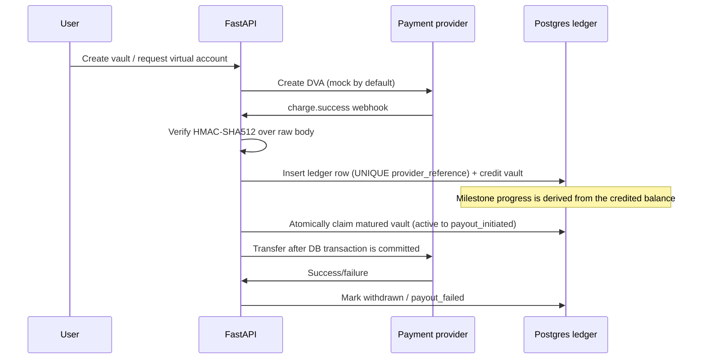

# Savings Vault Ledger

A standalone demo of a small fintech ledger service: customers fund locked vaults through provider webhooks, deposits become ledger entries, milestone progress follows balance changes, and matured vaults are paid out through a guarded provider call. It runs locally with a mock provider and needs no Supabase account or real payment credentials.

## Run locally

```sh
docker compose up --build
```

Open [Swagger UI](http://localhost:8000/docs). Seed login: `demo@example.test` / `demo-password-123`. The seed creates active, matured, and broken payout vaults. Use authenticated `POST /provider/mock/charge` to simulate a signed `charge.success` event through the actual webhook handler; the response exposes reached balance milestones. A seeded vault named "Broken payout" deterministically simulates transfer failure in mock mode. Mock virtual account provisioning is available at `POST /provider/dva`. Real mode uses the Paystack HTTP API for customer/DVA provisioning and requires a preconfigured `PAYSTACK_RECIPIENT_CODE` for payouts. The live adapter uses one operator-configured recipient for transfers, so it is not a safe multi-user payout setup. Keep mock mode for local demos; no live credentials or recipient are included.

## Flow



## Notable engineering decisions

- **Database idempotency:** `ledger_entries.provider_reference` has a database UNIQUE constraint. An application-level “does this exist?” query alone races: two webhook workers can both observe no row and both credit. The constraint serializes that decision at the database boundary; the loser rolls back the entire credit.
- **Webhook integrity:** HMAC-SHA512 verification uses the exact raw request bytes before JSON parsing. Parsing and serializing can change whitespace and key order, so verifying reconstructed JSON can reject valid signatures or verify the wrong bytes.
- **No lock during network I/O:** maturity first atomically changes the state and commits, releasing its database connection before calling the provider. Holding a row lock and pooled connection across a slow HTTP request can exhaust the pool under load.
- **Claim before transfer:** the `active to payout_initiated` state flip is a conditional database update committed before the transfer request. Concurrent workers can only claim one row; a later attempt sees a changed state and cannot double-pay.

## API

Auth: `POST /auth/register`, `POST /auth/token`. Use the returned bearer JWT for vault and DVA endpoints. Deposit webhook payloads are accepted only when signed with the configured Paystack secret. Swagger endpoint descriptions are included in the generated OpenAPI document.

## Checks

```sh
pip install -e '.[test]'
ruff check .
mypy app
pytest -q
```

See [docs/DECISIONS.md](docs/DECISIONS.md) for tradeoffs. The sample uses provider-neutral ledger references and never collects identity/KYC data.


